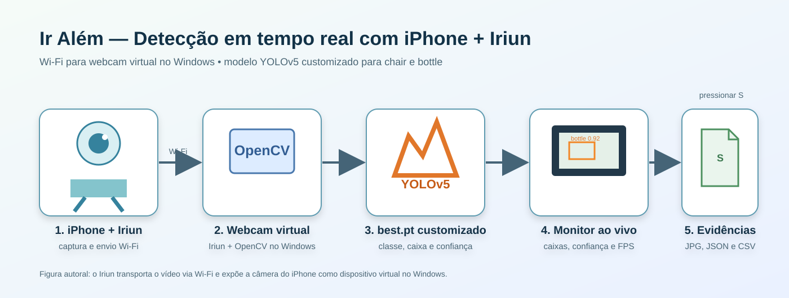

# Ir Além — Detecção em tempo real com webcam do PC

Este projeto demonstra a aplicação prática do modelo customizado da Entrega 1 em um fluxo de vídeo ao vivo. O iPhone, conectado ao Windows pelo **Iriun Webcam via Wi-Fi**, fornece os frames como uma webcam virtual; o modelo `best.pt` treinado para as classes `chair` e `bottle` realiza a inferência e a aplicação exibe as caixas delimitadoras, classes, confiança e FPS.

> Esta alternativa usa a webcam virtual do PC em vez de ESP32-CAM. Ela atende à opção prevista no enunciado: câmera conectada ao Python lendo o arquivo `best.pt` gerado na Entrega 1. O transporte sem fio entre iPhone e Windows é gerenciado pelo Iriun Webcam.

## Organização

```text
ir_alem_webcam/
├── docs/
│   └── arquitetura_webcam_pc.svg    # figura autoral da arquitetura
├── evidencias/                      # capturas reais da demonstração (geradas ao executar)
├── notebooks/
│   └── IrAlem_Webcam_PC.ipynb       # roteiro Jupyter independente
├── src/
│   └── webcam_yolo.py               # aplicação de detecção em tempo real
├── .gitignore
├── README.md
└── requirements.txt
```

O peso usado por padrão fica fora desta pasta, pois é resultado da Entrega 1: `../runs/treino_60ep/weights/best.pt`. O experimento de 60 épocas foi selecionado porque apresentou o melhor desempenho de teste documentado no notebook principal.

## Arquitetura



1. A câmera do iPhone envia vídeo ao Iriun Webcam Server no Windows pela mesma rede Wi-Fi.
2. O Iriun expõe o vídeo como webcam virtual, que o OpenCV lê localmente.
3. O Python pré-processa cada frame e envia-o para o YOLOv5 customizado (`best.pt`).
4. O modelo detecta as classes `chair` e `bottle`, devolvendo caixa, classe e confiança; a interface mostra também o FPS.
5. Ao pressionar `S`, o sistema grava a imagem original, a imagem anotada e os metadados da detecção em `evidencias/`.

## Justificativa crítica

A câmera do iPhone integrada pelo Iriun é uma escolha adequada para validar rapidamente a integração de visão computacional em cenário real: não requer hardware adicional, usa o mesmo modelo treinado na Entrega 1 e permite testar iluminação, distância, ângulo e fundos diferentes do dataset. A comunicação Wi-Fi é efetivamente exercitada entre celular e Windows; o Iriun abstrai essa camada e expõe uma webcam virtual ao Python. A solução não substitui o ESP32-CAM em uma implantação embarcada e remota — nesse caso haveria limitações próprias de energia, firmware e processamento. Para o objetivo didático de comprovar a coleta, transmissão e inferência ao vivo, ela é uma alternativa proporcional e reproduzível.

As imagens utilizadas para evidência devem ser produzidas durante a demonstração, em vez de serem fabricadas. O programa gera automaticamente os arquivos necessários quando o operador pressiona `S`.

## Como executar no Windows

No PowerShell, a partir da raiz `Farmtech_YOLO`:

```powershell
python -m venv .venv
.\.venv\Scripts\Activate.ps1
pip install -r .\ir_alem_webcam\requirements.txt
python .\ir_alem_webcam\src\webcam_yolo.py
```

Na primeira execução, o PyTorch pode baixar o repositório do YOLOv5 para o cache local. É necessário haver acesso à internet nessa primeira vez. Depois disso, o peso customizado já é lido do repositório local.

Se o carregamento informar `ModuleNotFoundError: No module named 'ultralytics'`, atualize as dependências com o mesmo ambiente virtual antes de executar novamente:

```powershell
.\.venv\Scripts\python.exe -m pip install -r .\ir_alem_webcam\requirements.txt
```

O programa também inclui uma compatibilidade automática para pesos `best.pt` salvos por uma versão mais nova do Python. Portanto, se o erro anterior mencionar `pathlib._local`, simplesmente execute o comando da webcam novamente após atualizar os arquivos do projeto.

### Controles e resultado esperado

- `S`: salva uma evidência (frame original, frame anotado, CSV e JSON).
- `Q` ou `Esc`: encerra a aplicação de forma segura.
- A janela deve apresentar caixas coloridas sobre cadeira e/ou garrafa, com a confiança e o FPS.

Para usar outra webcam, informe seu índice. Por exemplo, para a segunda câmera:

```powershell
python .\ir_alem_webcam\src\webcam_yolo.py --camera 1
```

Para descobrir o índice da webcam virtual do Iriun, execute antes:

```powershell
python .\ir_alem_webcam\src\listar_cameras.py
```

Se a câmera padrão não abrir no Windows, teste o backend Media Foundation:

```powershell
python .\ir_alem_webcam\src\webcam_yolo.py --backend msmf
```

## Evidências para o GitHub e vídeo

Após testar objetos reais ou imagens em uma TV, pressione `S` ao menos duas vezes em situações diferentes. A pasta `evidencias/` receberá, para cada captura:

- `raw_*.jpg`: frame sem anotações;
- `detected_*.jpg`: resultado processado pelo modelo;
- `capture_*.json`: parâmetros, FPS e detecções;
- `detections.csv`: registro consolidado das caixas detectadas.

O vídeo não listado do YouTube esta no link: https://youtu.be/usq37ZPnOis